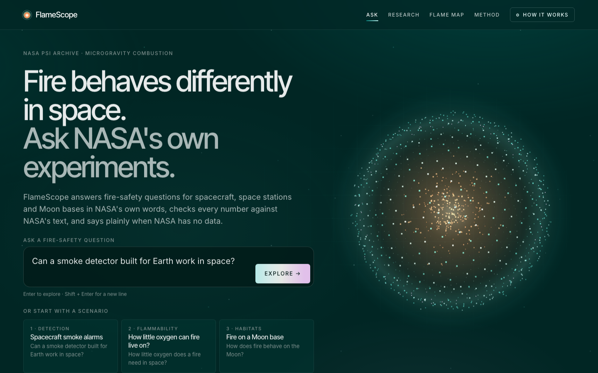
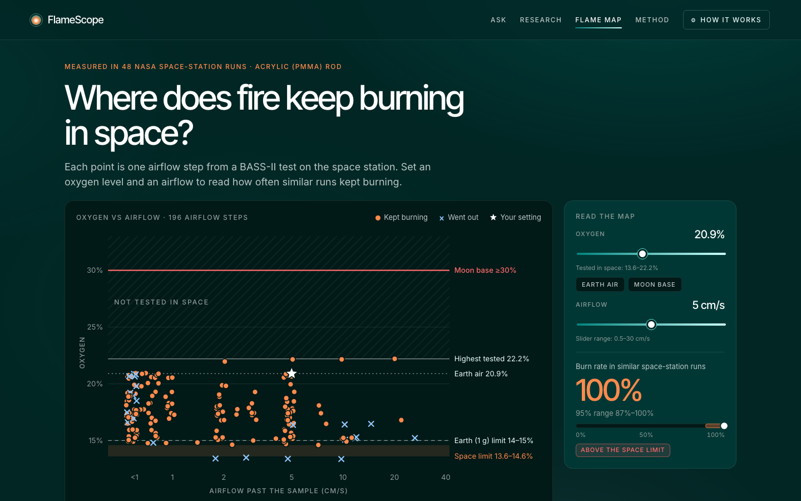
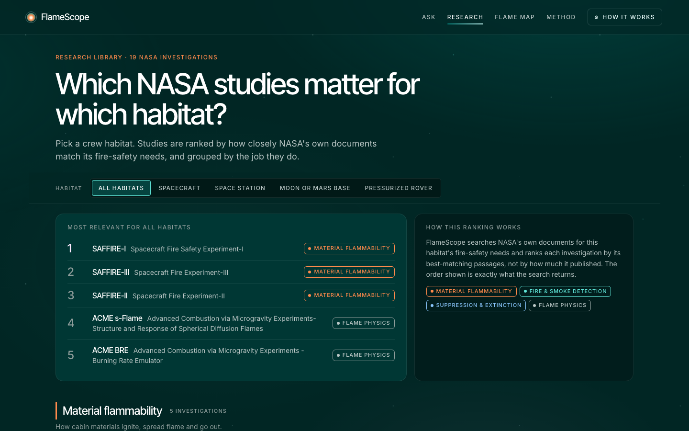
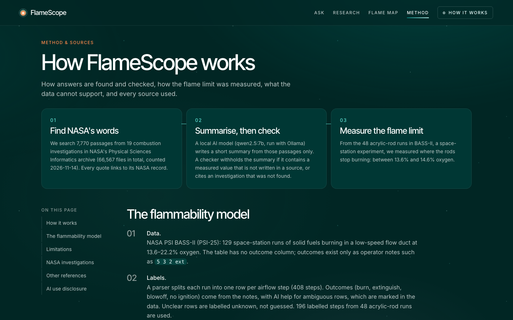
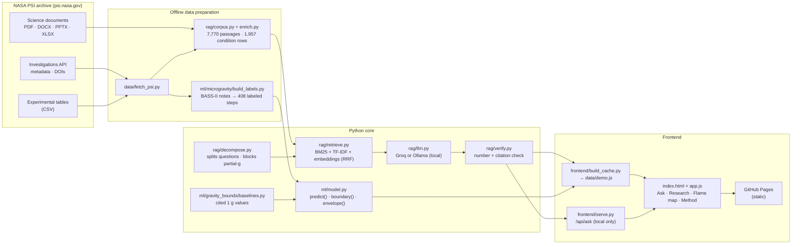

<div align="center">

# 🔥 FlameScope

### Fire-safety answers for spacecraft and Moon bases, in NASA's own words.

FlameScope searches NASA's microgravity combustion archive, checks every number against NASA's text,
measures where fire stops burning in space, and says plainly when NASA has no data.

[](https://md-zaid-10.github.io/Flame-in-Freefall-by-Cosmic-Outliers/)
[](https://www.spaceappschallenge.org/2026/challenges/flame-in-freefall/)
[](https://psi.nasa.gov/)


**[▶ Open the live demo](https://md-zaid-10.github.io/Flame-in-Freefall-by-Cosmic-Outliers/)** · Team **Cosmic Outliers** · Challenge: *Flame in Freefall*



</div>

---

## Contents

- [Overview](#-overview)
- [The challenge](#-the-challenge)
- [Our solution](#-our-solution)
- [Key features](#-key-features)
- [Screenshots and demo](#-screenshots-and-demo)
- [Technology stack](#-technology-stack)
- [Architecture](#-architecture)
- [NASA data and APIs](#-nasa-data-and-apis)
- [Installation and setup](#-installation-and-setup)
- [How to use](#-how-to-use)
- [Project structure](#-project-structure)
- [Challenges and learnings](#-challenges-and-learnings)
- [Limitations](#-limitations)
- [Future improvements](#-future-improvements)
- [Team](#-team)
- [AI use disclosure](#-ai-use-disclosure)
- [Acknowledgments](#-acknowledgments)
- [License](#-license)

---

## 🌍 Overview

Fire behaves differently in space. Without gravity there is no rising hot air, so flames are fed only by
whatever airflow the ventilation provides. Smoke particles grow larger, and materials can keep burning in
conditions where they would go out on Earth.

NASA has flown many combustion experiments on the International Space Station and other platforms. Their
results are openly published in NASA's **Physical Sciences Informatics (PSI)** archive, but they are spread
across thousands of files: reports, slide decks, spreadsheets and data tables. They are hard to find,
compare and interpret, especially for someone designing a habitat rather than studying combustion.

**FlameScope turns that archive into answers.** Ask a fire-safety question in plain English and you get:

- the passages from NASA's documents that answer it, each linked to its PSI record and DOI;
- a short AI summary that is shown only if every number and citation in it is found in those passages;
- measured values from NASA's experimental tables;
- a clear warning when the question goes beyond what NASA has tested, for example Moon or Mars gravity.

It also includes a **flame map** built from 196 airflow steps in the BASS-II space-station experiment. It
shows the lowest oxygen level at which acrylic still burned in microgravity, next to the published value on
Earth.

### Why it matters

NASA is planning crewed habitats on the Moon and pressurized rovers. The challenge brief states these are
expected to run at **30% oxygen or more and 10.2 psi or less**. That is well above Earth's 20.9%, and
materials burn more readily in oxygen-rich air. The people choosing cabin materials, smoke detectors and
extinguishers need to know what NASA has measured, and what it has not.

---

## 🎯 The challenge

**NASA Space Apps Challenge 2026: [Flame in Freefall: AI-Powered Fire Safety Insights from Microgravity Combustion Data](https://www.spaceappschallenge.org/2026/challenges/flame-in-freefall/)**

The challenge asks for an AI-powered dashboard that summarizes, ranks and interprets NASA's microgravity
combustion investigations, to deliver fire-safety insights for spacecraft, space stations, Moon and Mars bases
and pressurized rovers. Its suggested features, and where FlameScope addresses them:

| Suggested feature | Where in FlameScope |
|---|---|
| Find the investigations most relevant to habitat fire safety | **Research** page: 19 investigations ranked per habitat type |
| Extract data that supports predictive modeling of flammability | **Flame map**: 408 labeled airflow steps from 129 BASS-II runs, with a measured oxygen limit |
| Highlight research that informs next-generation fire-safety equipment | **Ask** page and the detection and suppression groups on the Research page (e.g. smoke-detector design from SAME) |
| Earth applications (optional) | "Fire safety on Earth" section, quoting NASA's own impact statements |

Two facts from the brief shaped the design:

1. **No partial-gravity combustion data exists in PSI yet.** Microgravity and Earth-gravity results can bound
   intermediate gravity, but they cannot predict it.
2. **A 30% oxygen Moon base is far outside what was tested.** BASS-II tested 13.6–22.2% oxygen.

---

## 💡 Our solution

FlameScope is built on one rule: **show NASA's words first, and never let the AI invent a number.**

- **Evidence before prose.** Every answer is an evidence ledger: the investigation, file, page and passage
  for each source. The AI summary is optional and comes second.
- **Mechanical verification.** A checker compares every number and every citation in the AI's draft against
  the retrieved NASA text. If anything is missing, the summary is withheld. The guarantee comes from the
  check, not from the model, so it runs on a small local model with no API key.
- **Honest refusals.** Questions about Moon or Mars gravity get a clear "NASA has no data here" answer
  instead of an extrapolation.
- **Measured, not modeled.** The flame map reports how often similar space-station runs kept burning, with
  95% intervals, instead of a curve fitted past the data.

---

## ✨ Key features

### 🔎 Ask: grounded question answering
- Hybrid search (keyword BM25 + TF-IDF + sentence embeddings, fused by reciprocal-rank fusion) over
  **7,770 passages** and **1,957 condition rows** from **19 investigations**.
- Answers show NASA's passages with page numbers and DOI links, plus an optional AI summary labeled
  *"AI summary · not NASA's words"*.
- Every number and citation in a summary is checked against the sources before it is shown.
- Three guided scenarios: **spacecraft smoke alarms**, **how little oxygen fire needs**, and **fire on a
  Moon base**.

### 🔥 Flame map: microgravity flammability from BASS-II
- 196 labeled airflow steps from 48 acrylic (PMMA) rod runs on the ISS, plotted as oxygen against airflow.
- Oxygen and airflow sliders show the observed burn rate of similar runs with a 95% interval.
- The microgravity flame limit, **13.6–14.6% oxygen**, shown next to the Earth limit of **14–15%** for the
  same rods (Marcum, Olson & Ferkul 2016).
- Earth air (20.9%), the highest oxygen tested (22.2%) and the planned Moon base (≥30%) are marked, with
  everything above 22.2% shaded as *not tested in space*.

### 🗺️ Research map: which studies matter for which habitat
- All 19 investigations grouped by job: **material flammability**, **fire & smoke detection**,
  **suppression & extinction**, **flame physics**.
- A habitat filter (spacecraft, space station, Moon or Mars base, pressurized rover) re-ranks them by how
  closely NASA's documents match that habitat's fire-safety needs.
- Notes where PSI has no study for a habitat, for example no rover-specific or partial-gravity study.
- A **Fire safety on Earth** section with NASA's own impact statements, such as smoke detectors for
  submarines.

### 📐 Method: transparent by design
- How answers are found and checked, how the flame limit was measured, every limitation, every
  investigation with its DOI, and an AI-use disclosure, all on the site.

---

## 🖼️ Screenshots and demo

**Live demo:** https://md-zaid-10.github.io/Flame-in-Freefall-by-Cosmic-Outliers/

| Flame map | Research map |
|---|---|
|  |  |

| Method and sources |
|---|
|  |

**Demo video:** `[add link to the ≤30 s demo video]`

> The public site is static. The three scenarios, nine example questions, research map, flame map and method
> page all work there. Answers to **new** questions need the local server and a local AI model; see
> [Installation and setup](#-installation-and-setup).

**Keyboard shortcuts:** `1` `2` `3` scenarios · `→` / `n` next question · `m` flame map ·
`d` "How it works" drawer · `Esc` / `h` home. Screens can be linked directly:
`#smoke`, `#oxygen`, `#moon`, `#research`, `#map`, `#method`.

---

## 🧰 Technology stack

| Layer | Technologies |
|---|---|
| **Frontend** | Plain HTML, CSS and JavaScript, with no framework and no build step. Charts are hand-drawn SVG. |
| **Backend** | Python 3.12 standard-library HTTP server (`frontend/serve.py`) exposing `/api/ask` and `/api/health` |
| **Retrieval** | `rank-bm25`, scikit-learn TF-IDF, `sentence-transformers` (`all-MiniLM-L6-v2`), reciprocal-rank fusion |
| **AI summaries** | [Groq](https://groq.com/) API (free tier; picks the best available model, e.g. `openai/gpt-oss-120b`) when `GROQ_API_KEY` is set, otherwise a local model through [Ollama](https://ollama.com/) (`qwen2.5:7b`). If Groq hits its rate limit, answers fall back to Ollama. An Anthropic backend is optional. |
| **Data and modeling** | pandas, NumPy, SciPy (Jeffreys intervals), matplotlib |
| **Document extraction** | pypdf, python-docx, python-pptx, openpyxl |
| **Data source** | NASA Physical Sciences Informatics (PSI) web API |
| **Hosting** | GitHub Pages, deployed by GitHub Actions |
| **Storage** | Flat files (JSON, JSONL, CSV) committed to the repo. No database. |

---

## 🏗️ Architecture



**How the parts communicate**

1. **Preparation (offline).** `data/fetch_psi.py` downloads investigation metadata and experimental tables
   from the PSI API. `rag/corpus.py` turns documents and tables into searchable passages and condition rows.
   `build_labels.py` parses BASS-II operator notes into one labeled row per airflow step.
2. **Answering.** `rag/search.py` is the entry point: `search()`, `summarize()` and `ask()`. A question is
   split if it is compound, checked for Moon or Mars gravity, searched with three methods whose rankings are
   fused, drafted by the local model, then verified. Drafts that fail verification are withheld; the
   evidence is still shown.
3. **Modeling.** `ml/model.py` exposes `predict(material, thickness_mm, o2_pct, flow_cm_s, pressure_kpa,
   gravity_g)` and `boundary(material, gravity_g)`. Results are `NaN` where there is no data, and the UI
   shows that as "no data", never as "safe".
4. **Delivery.** `frontend/build_cache.py` pre-computes the scenarios, example answers, research rankings and
   every flame-map slider position into `frontend/data/demo.js`, so the browser never reimplements the model
   and the public site needs no server. The build fails if a headline quote is no longer found word for word
   in NASA's text. Locally, `serve.py` adds live answers for any new question.

---

## 🛰️ NASA data and APIs

All data comes from NASA's **[Physical Sciences Informatics (PSI)](https://psi.nasa.gov/)** archive, accessed
through its public web API:

- Investigation records: `https://psi.nasa.gov/geode-py/ws/repo/investigations/{PSI-ID}`
- File downloads: `https://psi.nasa.gov/geode-py/ws/studies/{study_id}/download?...`

**Coverage:** 66,567 files across 24 combustion investigations (counted 2026-11-14). 19 of them publish
usable documents and are searchable in FlameScope. Exclusions are documented in
[`data/rag/EXCLUDED_INVESTIGATIONS.md`](data/rag/EXCLUDED_INVESTIGATIONS.md).

| Group | Investigations (PSI ID · DOI) |
|---|---|
| **Material flammability** | BASS-II ([PSI-25](https://doi.org/10.60555/4qc4-de67)) · BASS ([PSI-26](https://doi.org/10.60555/58h4-dy80)) · SAFFIRE-I ([PSI-98](https://doi.org/10.60555/0t15-1z43)) · SAFFIRE-II ([PSI-99](https://doi.org/10.60555/2chp-m469)) · SAFFIRE-III ([PSI-100](https://doi.org/10.60555/040q-4h36)) |
| **Fire & smoke detection** | SAME ([PSI-102](https://doi.org/10.60555/gd4k-8h62)) · SAME-R ([PSI-101](https://doi.org/10.60555/2np7-jv14)) · DAFT / DAFT-2 ([PSI-47](https://doi.org/10.60555/ztgj-d202)) · SAME data for smoke modeling ([PSI-115](https://doi.org/10.60555/q0v5-1v28)) |
| **Suppression & extinction** | FLEX ([PSI-69](https://doi.org/10.60555/mbq8-0451)) · FLEX-2 ([PSI-68](https://doi.org/10.60555/byp8-h018)) · Cool-flame CFD analysis ([PSI-117](https://doi.org/10.60555/gz0q-b577)) |
| **Flame physics** | ACME Flame Design ([PSI-10](https://doi.org/10.60555/w4zy-bt45)) · ACME BRE ([PSI-20](https://doi.org/10.60555/vb93-3y72)) · ACME E-FIELD ([PSI-22](https://doi.org/10.60555/se5a-8c73)) · ACME s-Flame ([PSI-23](https://doi.org/10.60555/k57n-p030)) · ACME CFI-G ([PSI-159](https://doi.org/10.60555/cyt1-kh64)) · CFI ([PSI-39](https://doi.org/10.60555/m6pj-a914)) · SPICE ([PSI-107](https://doi.org/10.60555/9kbh-e962)) |

**From archive to screen**

- **Collected:** `data/fetch_psi.py` saves metadata to `data/metadata.json` and experimental tables to
  `data/raw/tables/`. `rag/prep/` downloads and extracts the science documents (~700 MB, not committed).
- **Processed:** documents become 7,770 passages, and tables become 1,957 condition rows with their source
  row kept verbatim. The BASS-II table (129 ISS runs) has **no outcome column**: outcomes exist only as
  operator notes such as `5 3 2 ext`. A parser splits each run into airflow steps and labels each one burn,
  extinguish, blowoff or no ignition.
- **Visualized:** passages and condition rows on the Ask page, rankings on the Research page, and labeled
  steps on the flame map.

**External reference (Earth baseline):** Marcum J.W., Olson S.L., Ferkul P.V. (2016), *Correlation of normal
gravity mixed convection blowoff limits with microgravity forced flow blowoff limits*,
[NASA NTRS 20160012691](https://ntrs.nasa.gov/citations/20160012691).

> FlameScope is an independent student project for NASA Space Apps. It is not affiliated with or endorsed by
> NASA. Mentions of NASA refer to its publicly available data.

---

## ⚙️ Installation and setup

### Prerequisites

- **Python 3.12** (other recent 3.x versions will likely work but were not tested)
- **Git**
- For live AI answers to new questions (optional), either a free **[Groq API key](https://console.groq.com/keys)** or **[Ollama](https://ollama.com/)** running locally
- About 2 GB of disk space for Python dependencies (PyTorch is pulled in by `sentence-transformers`)

### 1. Clone the repository

```bash
git clone https://github.com/md-zaid-10/Flame-in-Freefall-by-Cosmic-Outliers.git
cd Flame-in-Freefall-by-Cosmic-Outliers
```

### 2. Just view it (no installs)

The prepared scenarios, research map, flame map and method page are pre-computed, so you can open the page
directly:

```bash
open frontend/index.html          # macOS; on other systems open the file in any browser
```

### 3. Full setup with live questions

```bash
python3.12 -m venv venv
source venv/bin/activate          # Windows: venv\Scripts\activate
pip install -r requirements.txt

export GROQ_API_KEY=your_key_here  # optional: fast cloud summaries (never commit this)
ollama pull qwen2.5:7b            # optional: local model, also the fallback for Groq
python frontend/serve.py          # → http://localhost:8765
```

On the first search, the embedding model (`all-MiniLM-L6-v2`) downloads, and passage embeddings are
computed and cached in `data/rag/embeddings.npy`. This takes about a minute. With neither Groq nor Ollama available,
searches still return NASA's passages and measured values, just without an AI summary.

### Environment variables (all optional)

| Variable | Default | Purpose |
|---|---|---|
| `PORT` | `8765` | Port for `frontend/serve.py` |
| `GROQ_API_KEY` | none | Groq API key. When set, Groq writes the summaries. Keep it server-side; never commit it. |
| `FIF_GROQ_MODEL` | auto | Pin a Groq model; by default the best model the key can reach is chosen |
| `FIF_LLM` | auto | Force one backend: `groq`, `ollama` or `anthropic`. Unset: Groq if a key is set, else Ollama. |
| `FIF_OLLAMA_MODEL` | `qwen2.5:7b` | Ollama model name |
| `FIF_OLLAMA_HOST` | `http://localhost:11434` | Ollama server address |
| `ANTHROPIC_API_KEY` | none | Needed only when `FIF_LLM=anthropic` |

No `.env` file is required.

### Rebuilding data (optional)

The processed corpus, tables and labels are committed, so none of this is needed to run the app.

```bash
python data/fetch_psi.py                      # PSI metadata + experimental tables
python -m rag.prep.build_manifest             # list document files in PSI
python -m rag.prep.download_documents         # ~700 MB of science documents
python -m rag.prep.check_extraction           # check which text is usable
python -m rag.corpus && python -m rag.enrich  # build passages + condition rows
python -m rag.evaluate --k 5                  # retrieval scorecard

python ml/microgravity/build_labels.py        # BASS-II notes → labeled steps
python ml/microgravity/plot_envelope.py       # flame-map figures in ml/figures/

python frontend/build_cache.py --keep-answers # regenerate frontend/data/demo.js
```

---

## 🧭 How to use

1. **Start with a scenario.** Press `1`, `2` or `3`, or click a scenario card:
   - *Can a smoke detector built for Earth work in space?* opens with NASA's own sentence: "Smoke detector
     design must be based on low-g data".
   - *How little oxygen does a fire need in space?* shows the measured space limit (13.6–14.6%) against
     Earth (14–15%) and the planned Moon base (≥30%).
   - *How does fire behave on the Moon?* shows that NASA has flame limits only at 0 g and 1 g, and no data at
     Moon (~1/6 g) or Mars (~1/3 g) gravity.
2. **Ask your own question.** Type it in the box and press Enter. Read NASA's passages first; the AI summary
   is a convenience and is labeled as such. Try a prepared example from **More questions to try**, such as
   *"How do you put out a fire in space?"*
3. **Explore the flame map** (`m`). Move the oxygen and airflow sliders, or use the *Earth air* and *Moon
   base* buttons, to see how often similar space-station runs kept burning.
4. **Pick a habitat on the Research page.** Choose spacecraft, space station, Moon or Mars base, or
   pressurized rover to re-rank the 19 investigations, and follow the DOI links to NASA's records.
5. **Check the method.** Press `d` for the "How it works" drawer (verification verdicts, files, pages) or
   open **Method** for the full pipeline, limitations and sources.

**From Python:**

```python
from rag import search as rag
import sys; sys.path.insert(0, "ml")
import model

rag.search("smoke detection in microgravity", k=3)   # → [{"id", "title", "score", "snippet", "doi"}, ...]
rag.ask("How do you put out a fire in space?")        # → answer, evidence, grounding, gaps, sources, ...
model.predict("PMMA rod", 9.5, 17, 5)                 # → {"p_burn": 0.94, "low": 0.76, "high": 0.99}
model.predict("cotton", 1, 21, 5)                     # → all NaN: no data for this material
```

---

## 📁 Project structure

```
.
├── frontend/                 # The web app
│   ├── index.html            # Page shell
│   ├── app.js                # All screens: Ask, Research, Flame map, Method
│   ├── style.css             # Design system (dark teal)
│   ├── serve.py              # Local server: static files + /api/ask
│   ├── build_cache.py        # Pre-computes data/demo.js from rag/ and ml/
│   ├── shape.py              # Cleans answer payloads for display
│   ├── count_psi_files.py    # Counts files in the PSI archive for the home screen
│   └── data/                 # demo.js (pre-computed site data), psi_file_count.json
├── rag/                      # Retrieval, answering and verification
│   ├── search.py             # Public interface: search(), summarize(), ask()
│   ├── retrieve.py           # Hybrid BM25 + TF-IDF + embedding search
│   ├── decompose.py          # Splits compound questions; blocks partial-g extrapolation
│   ├── answer.py             # Builds the evidence ledger
│   ├── verify.py             # Number and citation grounding check
│   ├── llm.py                # Groq / Ollama / Anthropic backend
│   ├── corpus.py, enrich.py  # Build and clean the passage corpus
│   ├── evaluate.py           # Retrieval scorecard against a gold set
│   └── prep/                 # One-off document download and extraction
├── ml/                       # Flammability model
│   ├── model.py              # Public interface: predict(), boundary(), envelope()
│   ├── microgravity/         # BASS-II labels, parser, envelope model, label re-check
│   ├── gravity_bounds/       # Cited Earth (1 g) and habitat reference values
│   └── figures/              # Flame-map figures and point data
├── data/
│   ├── fetch_psi.py          # Downloads PSI metadata and tables
│   ├── metadata.json         # Per-investigation title, DOI, objective, impacts
│   ├── raw/tables/           # PSI experimental tables (CSV)
│   └── rag/                  # Passages, condition rows, gold set, eval results
├── docs/                     # Validation checklist, screenshots
├── demo.ipynb                # Quick look at the BASS-II table and labels
├── requirements.txt
└── .github/workflows/pages.yml   # Deploys frontend/ to GitHub Pages
```

---

## 🧪 Challenges and learnings

- **The key data had no outcome column.** BASS-II records airflow settings and gas readings, but whether the
  flame kept burning lives only in operator shorthand such as `"pot 0.9 0.5 and down" / "5 3 2 ext"`. We wrote
  a parser that splits each run into airflow steps, turning 129 runs into 408 labeled rows. Unclear steps are
  labeled *unknown* rather than guessed. A second, blind labeling pass agreed on **96.7%** of 30 sampled
  steps. That measures consistency, not human validation.
- **Logistic regression gave unphysical results.** Operators lowered airflow until every flame went out, so
  the extinctions say almost nothing about oxygen. We replaced the fit with an empirical envelope: the observed
  burn rate per oxygen × airflow cell, counted once per run, with 95% Jeffreys intervals.
- **Small language models make up numbers.** Rather than trust the model, we check it: every number in a
  draft must appear word for word in the retrieved sources, and every citation must point at something that
  was retrieved. This is why a local 7B model is enough.
- **The checker has limits, so we reviewed by hand too.** It cannot tell whether a sentence *reads* a
  number correctly. We reviewed the cached AI answers and removed three that misread or misattributed NASA's
  text. The review is recorded in
  [`docs/scientific-validation-checklist.md`](docs/scientific-validation-checklist.md).
- **Coverage is very uneven.** ACME BRE has about 1,600 passages and SAFFIRE-I has one. Ranking by
  document volume would make every fire-safety question return gas-flame studies. So each investigation is
  scored on its best few passages, not its total, plus a small boost from PSI's own research-area labels.
  Investigations with thin evidence are labeled on screen.
- **Saying "no data" is a feature.** Moon and Mars questions are detected and answered with what NASA has
  not measured, instead of an extrapolation that looks confident.

**Measured retrieval quality** (`python -m rag.evaluate --k 5`, 26 hand-built cases in
[`data/rag/gold_set.json`](data/rag/gold_set.json)): all 26 cases pass, including Recall@5 18/18, correct
refusals 4/4 and question decomposition 2/2.

---

## ⚠️ Limitations

- Only **acrylic (PMMA) rods** have enough runs for a flame limit. Other materials return "no data".
- BASS-II has no pressure column; space-station cabin pressure is assumed.
- PSI has **no partial-gravity (Moon or Mars) combustion data**. Nothing is extrapolated to those gravity levels.
- Everything above **22.2% oxygen** is outside the tested range. A 30% Moon base sits 7.8 points beyond it.
- The checker proves numbers and citations exist in the sources, not that the AI's reasoning is right.
  AI summaries are labeled and can be wrong; trust NASA's passages.
- Matching table columns to condition names is heuristic, because PSI's CSV headers vary between
  investigations. The original value and source row are always shown.

---

## 🚀 Future improvements

- **Partial-gravity data.** Add Moon and Mars results when future experiments such as LUCI and FM2 publish to
  PSI, and replace the "no data" bands with measurements.
- **More materials.** Extend the flame map to PMMA films and slabs, SIBAL and Nomex from BASS-II, and to
  Saffire's large-scale samples.
- **Pressure and oxygen together.** Use published reduced-pressure, enriched-oxygen studies to bound
  habitat conditions such as 30% oxygen at 10.2 psi.
- **Equipment view.** A dedicated page linking each finding to the hardware it informs: smoke detectors,
  extinguishers, ventilation shutdown.
- **Stronger checking.** Verify that each cited passage actually *supports* its sentence, not only that it
  was retrieved.
- **Hosted live answers.** Run the answer service in the cloud so the public site can answer any question.

---

## 👥 Team

**Cosmic Outliers**: NASA Space Apps Challenge 2026

| Member | Role | Links |
|---|---|---|
| **Zaid** | ML: BASS-II labels, flammability model and uncertainty, `predict()`; web app and deployment | `[GitHub / LinkedIn]` |
| **Ananya** | RAG / LLM: search, ranking, grounded answers, verification, evaluation | `[GitHub / LinkedIn]` |
| **Jaisheel** | `[confirm role and contributions]` | `[GitHub / LinkedIn]` |

---

## 🤖 AI use disclosure

In line with Space Apps rules:

- Code for the parser, model, search, checker and website was written with AI coding assistance (Claude) and
  reviewed by the team.
- Outcome labels for ambiguous space-station notes were extracted with AI help and are marked as such in
  the data (`label_source`).
- Answer summaries on the site are generated by a local AI model (`qwen2.5:7b`), labeled "AI summary", and
  checked against NASA's text before they are shown.
- The project idea and scientific framing are the team's own. No AI-generated images are used. All
  screenshots are of the actual app.

---

## 🙏 Acknowledgments

- **[NASA Space Apps Challenge](https://www.spaceappschallenge.org/)** and the authors of the *Flame in
  Freefall* challenge.
- **[NASA Physical Sciences Informatics (PSI)](https://psi.nasa.gov/)** and the principal investigators and
  teams behind BASS, BASS-II, Saffire, SAME, SAME-R, DAFT, FLEX, FLEX-2, CFI, ACME and SPICE, whose openly
  published data makes this project possible.
- **Marcum, Olson & Ferkul (2016)** for the published Earth-gravity blowoff limits used as the 1 g baseline.
- [Groq](https://groq.com/) for fast hosted inference.
- Open-source tools: [Ollama](https://ollama.com/), [Qwen2.5](https://github.com/QwenLM/Qwen2.5),
  [sentence-transformers](https://www.sbert.net/), [rank-bm25](https://github.com/dorianbrown/rank_bm25),
  [scikit-learn](https://scikit-learn.org/), [pandas](https://pandas.pydata.org/),
  [NumPy](https://numpy.org/), [SciPy](https://scipy.org/), [matplotlib](https://matplotlib.org/),
  [pypdf](https://github.com/py-pdf/pypdf), python-docx, python-pptx and openpyxl.
- Fonts: [Inter and Inter Tight](https://rsms.me/inter/) via Google Fonts.

---

## 📄 License

`[No license has been chosen yet.]` Until a `LICENSE` file is added, all rights are reserved by the authors
by default. NASA PSI data remains subject to NASA's own terms of use.
